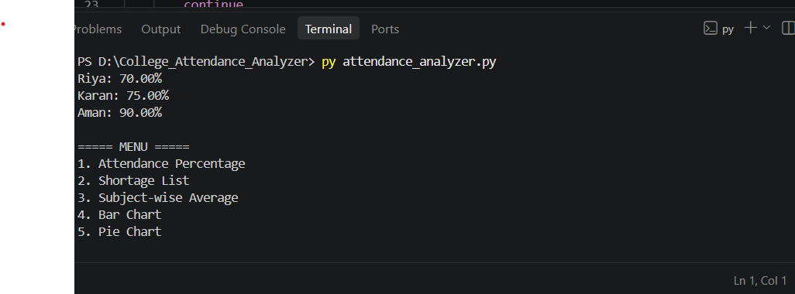
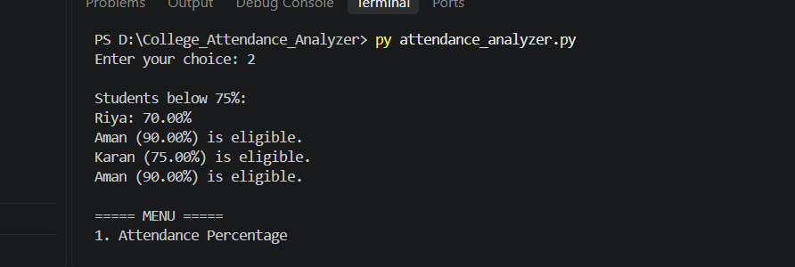
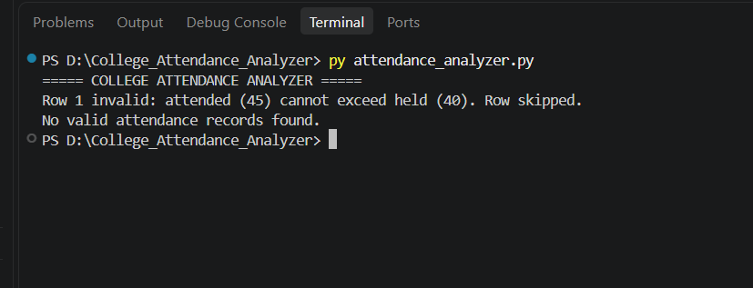
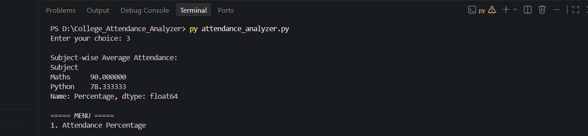
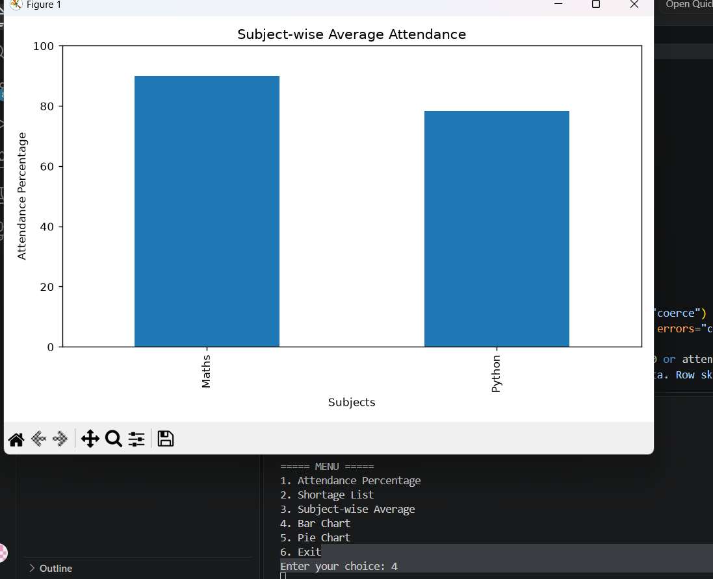
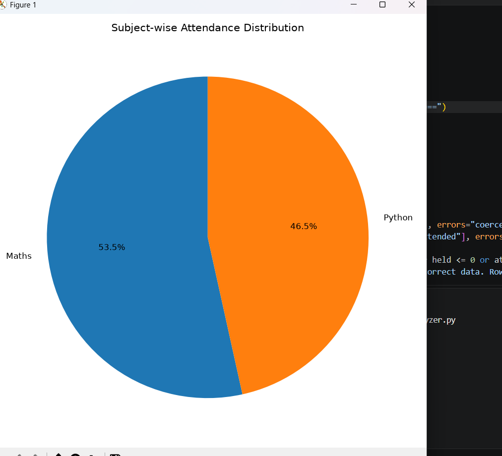

# Project Summary: College Attendance Analyzer

## 1. Implementation

The College Attendance Analyzer was developed using Python.

The project uses:
- Pandas for reading and processing attendance data.
- CSV file for storing student attendance records.
- Matplotlib for creating charts.

The program reads attendance data from the CSV file and validates the records. It calculates attendance percentages, identifies students below the minimum attendance requirement of 75%, and calculates subject-wise average attendance.

It also displays attendance data using bar charts and pie charts.

## 2. Screenshots

The following screenshots show the outputs of the project:

1. 01_Attendance_Percentage.png
2. 02_Shortage_List.png
3. 03_Invalid_Input.png
4. 04_Subject_Wise_Average.png
5. 05_Bar_Chart.png
6. 06_Pie_Chart.png

### Screenshot Outputs

## 3. Test Cases

### Test Case 1: Normal Input
- Input: Valid attendance records.
- Expected Output: Correct attendance percentages.
- Result: Passed.

### Test Case 2: Boundary Input
- Input: Attendance at exactly 75%.
- Expected Output: Student should be eligible.
- Result: Passed.

### Test Case 3: Invalid Input
- Input: 40 classes held and 45 classes attended.
- Expected Output: Invalid record should be skipped.
- Result: Passed.

### Test Case 4: Subject-wise Analysis
- Input: Valid records for Python and Maths.
- Expected Output: Subject-wise average attendance and bar chart.
- Result: Passed.